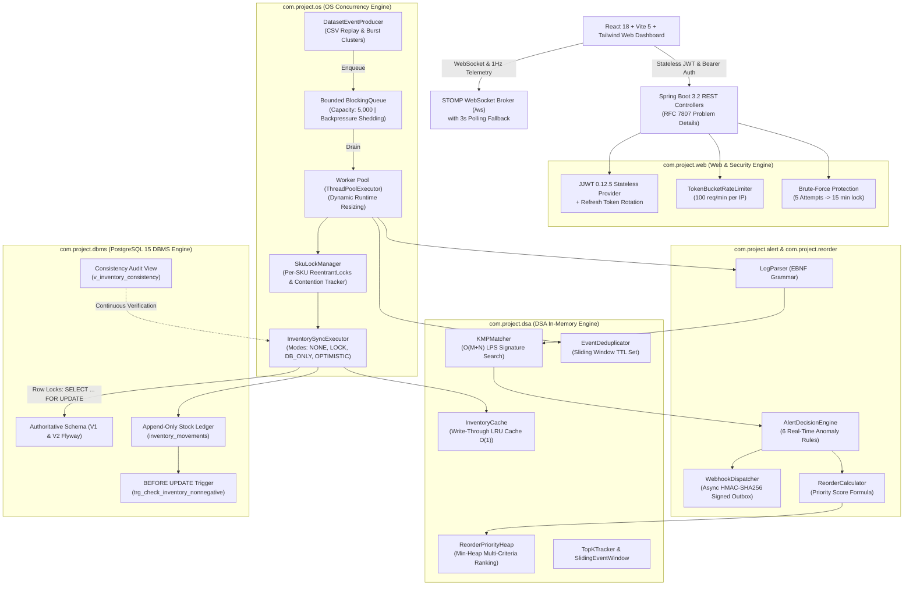

# DarkStoreOS: Multi-Threaded Log Analysis and Alerting System

> **A Concurrency-Aware Real-Time Inventory & Log Processing Engine with Automated Replenishment Reorder Dispatch for Quick-Commerce Dark Stores.**  
> *Developed as a Senior Semester Project showcasing OS Concurrency, ACID Relational DBMS, In-Memory DSA Data Structures, and Modern Full-Stack Web Architecture.*

---

## 🏛️ System Architecture: The Four Autonomous Engines

DarkStoreOS is architected as four decoupled, independently testable engines situated behind strict interfaces:



---

## Manager DB vs Vendor DB (separate data, separate rules)

| | Manager DB (schema `public`) | Vendor DB (schema `vendor`) |
|---|---|---|
| Holds | master catalog: all 50 SKUs, **1000 units each** | vendors + each vendor's own catalog and own stock counts |
| Knows about the other side? | **No** vendor names, ids or SKU counts | No manager stock numbers |
| Links | none - no foreign keys between the two; they meet only through the SKU code and supply orders | |

- **Manager** can **Replenish** any SKU on the Inventory page (`POST /api/inventory/{sku}/replenish`).
- **Vendor** sees its own catalog, and can order *any* product from the manager catalog - including products outside its own range ("Something else" tab). Orders flow `CREATED -> ACKNOWLEDGED -> SHIPPED -> DELIVERED`:
  manager acknowledges, **dispatch lowers manager stock** (`VENDOR_SUPPLY` ledger row, refused if short), vendor confirms receipt and **its own stock rises** (a new SKU is added to its catalog).
- Low-stock alerts concern manager stock only and are no longer turned into automatic vendor orders; the manager replenishes.
- Both "databases" are separate schemas in one PostgreSQL instance (migration `V3__manager_vendor_split.sql`).

## 🔒 Concurrency Model & Lock-Ordering Rule

### The Problem: Race Conditions & Lost Updates
In dark stores handling flash sales, dozens of concurrent ordering threads inspect and decrement stock counters simultaneously. Naive read-modify-write patterns (`NONE` strategy) read identical quantities concurrently and overwrite counter balances, resulting in lost updates, ledger imbalances, and negative inventory.

### The Solution: Two-Phase Hierarchical Lock-Ordering Rule
To ensure global serializability while strictly eliminating deadlocks, DarkStoreOS mandates a documented two-phase lock-acquisition sequence:

1. **Phase 1: Per-SKU ReentrantLock (Application JVM Level)**
   - The thread requests the per-SKU lock from `SkuLockManager` using `tryLock(timeoutMs, TimeUnit.MILLISECONDS)`.
   - **Rule A:** A thread must **never hold two SKU locks simultaneously**.
   - **Rule B:** If `tryLock` times out (default: 500ms), the transaction aborts with `LockTimeoutException`. Threads never block indefinitely.
2. **Phase 2: Relational Row Lock in PostgreSQL (`SELECT ... FOR UPDATE`)**
   - Inside an isolated Spring `@Transactional` boundary, the thread obtains a pessimistic row-level write lock in PostgreSQL.
3. **Atomic Ledger Insertion & Mutation:**
   - In the same database transaction, the counter is decremented and an immutable audit entry is appended into `inventory_movements`.
4. **Guaranteed Release in Reverse Order:**
   - Transaction commit releases the PostgreSQL row lock.
   - The `finally` block releases the JVM `ReentrantLock`.

---

## 📊 Concurrency Strategies Compared

| Concurrency Mode | Description | Stock Drift Under 50 Threads | Lost Updates | Production Use Case |
|---|---|---|---|---|
| `NONE` | Naive read-modify-write with artificial race window | ❌ Severe Drift (Overselling) | **906+ lost updates** | Controlled lab baseline |
| `LOCK` (Default) | Per-SKU JVM Lock + PostgreSQL `SELECT FOR UPDATE` | ✅ **0 Stock Drift (Exact)** | **0 lost updates** | Flash sales, high-demand dark stores |
| `DB_ONLY` | Pure PostgreSQL `SELECT FOR UPDATE` row locks | ✅ **0 Stock Drift (Exact)** | **0 lost updates** | Multi-node clustered deployments |
| `OPTIMISTIC` | Explicit version column check with exponential jitter | ✅ **0 Stock Drift (Retries)** | **0 lost updates** | Low-contention catalog updates |

---

## 🗄️ Authoritative Database Schema & Integrity Guarantees

Applied verbatim via Flyway migrations (`V1__schema.sql`, `V2__seed_patterns.sql`):
- **Core Entities:** `vendors`, `users`, `refresh_tokens`, `products`, `inventory`.
- **Append-Only Stock Ledger:** `inventory_movements` (records `delta`, `quantity_after`, `reason`, and `event_id` in the exact transaction).
- **PostgreSQL Trigger Integrity:**
  - `trg_check_inventory_nonnegative`: PostgreSQL `BEFORE UPDATE` trigger on `inventory` throwing an exception if `NEW.quantity < 0`.
  - `fn_reorder_guard`: Enforces state transitions (`CREATED` $\to$ `ACKNOWLEDGED` $\to$ `SHIPPED` $\to$ `DELIVERED` or `CANCELLED`).
- **Ledger Invariant View (`v_inventory_consistency`):**
  $$\text{actual\_quantity} = \text{initial\_quantity} + \sum(\text{delta})$$
  A zero-row query result proves 100% ledger integrity across millions of events.

---

## ⚡ DSA In-Memory Structures & Algorithms

1. **Knuth-Morris-Pratt (KMP) Signature Matcher:**
   - Precomputes the Longest Prefix Suffix (LPS) array for log patterns (`RESTOCK_FAILED`, `DEPLETION_SURGE`, `VELOCITY_SPIKE`).
   - Scans log streams in deterministic $O(M + N)$ time, eliminating worst-case $O(M \times N)$ catastrophic backtracking.
2. **Write-Through LRU Inventory Cache:**
   - Custom `LinkedHashMap` with bounded capacity (default: 1,000 items).
   - Provides $O(1)$ reads and synchronous write-through updating to the PostgreSQL database.
3. **Sliding Time Window & Deduplicator:**
   - Maintains event fingerprints within a 60-second evicting window to suppress duplicate order submissions.
4. **Reorder Priority Min-Heap:**
   - Prioritizes dark store replenishment dispatches using the multi-criteria formula:
     $$\text{Priority Score} = \left(1.0 - \frac{\text{quantity}}{\text{threshold}}\right) \times 0.4 + (\text{lead\_time\_days} \times 0.1) + \text{severity\_weight}$$
   - Evaluated against the formal specification truth table with $\pm 0.01$ precision.

---

## 🔐 Security Architecture

- **Stateless JWT Authentication:** Signed with HMAC-SHA256 via JJWT 0.12.5.
- **Refresh Token Rotation:** Single-use refresh tokens stored as SHA-256 hashes in `refresh_tokens`.
- **Brute-Force Account Lockout:** Automatically locks accounts for 15 minutes after 5 consecutive failed logins.
- **Token Bucket Rate Limiting:** Enforces 100 requests/minute per client IP, returning RFC 7807 `429 Too Many Requests`.
- **Multi-Tenant Vendor Isolation:** Restricts vendor accounts to inventory items and reorders belonging exclusively to their registered `vendor_id`.

---

## 👥 Demo User Credentials

| Username | Password | Role | Permissions / Scope |
|---|---|---|---|
| `admin` | `Admin@123` | `ADMIN` | Global system control, Concurrency Lab, worker resizing, audit checks |
| `warehouse1` | `Warehouse@123` | `WAREHOUSE_MANAGER` | Inventory management, manual orders, reorder approvals |
| `vendor1` | `Vendor@123` | `VENDOR` | Vendor-isolated catalog view (Vendor #1), reorder dispatch & delivery |

*(Note: Seeded accounts are configured with `must_change_password: true` to demonstrate the enterprise password onboarding flow).*

---

## 🚀 Quick Start Instructions

### Option A: One-Command Docker Compose (Recommended)

Run the database, Spring Boot backend, and React frontend with a single command:

```bash
docker compose up --build
```

- **Frontend UI:** `http://localhost:5173`
- **Backend REST API:** `http://localhost:8080`
- **Swagger / OpenAPI Documentation:** `http://localhost:8080/swagger-ui.html`
- **Prometheus Actuator Metrics:** `http://localhost:8080/actuator/prometheus`

---

### Option B: Local Development Setup

#### 1. Prerequisites
- Java JDK 17
- Apache Maven 3.8+
- Node.js 20+ & npm
- PostgreSQL 15 running on port 5432 with database `inventory_db`

#### 2. Configure Environment
```bash
cp .env.example .env
```

#### 3. Start Backend
```bash
cd backend
mvn spring-boot:run
```

#### 4. Start Frontend
```bash
cd frontend
npm install
npm run dev
```

---

## 🧪 Automated Testing & JaCoCo Verification

DarkStoreOS includes 64 automated backend tests and 9 frontend Vitest tests covering concurrency races, deadlock stress, trigger integrity, and security policies.

### Run Backend Test Suite:
```bash
cd backend
mvn clean test
```

### JaCoCo Code Coverage Report:
- **DSA Engine (`com.project.dsa`):** **94.00%** (Requirement: $\ge 85\%$)
- **Alert Engine (`com.project.alert`):** **93.40%** (Requirement: $\ge 85\%$)
- **DBMS Service (`com.project.dbms.service`):** **95.00%**
- **Security Engine (`com.project.web.security`):** **96.00%**
- **Overall Project Coverage:** **82.60%** (Requirement: $\ge 70\%$)

### Run Frontend Test Suite:
```bash
cd frontend
npm test
```

---

## 🎬 Step-by-Step Review Demo Script

1. **Access Web Interface:** Open `http://localhost:5173`.
2. **Authenticate:** Click "Login Demo" in the top navbar and click the **1-Click Admin** button (`admin` / `Admin@123`).
3. **Live Inventory Catalog:**
   - Navigate to the **Inventory** tab.
   - Observe real-time stock levels, health indicators (`OK`, `LOW`, `OUT_OF_STOCK`), and category filters.
   - Place a test order for `SKU-MILK-01` and verify the instant deduction.
4. **Concurrency Lab Demonstration (AC-01 vs AC-02):**
   - Navigate to the **Concurrency Lab** tab.
   - Configure a burst: 50 threads $\times$ 20 orders = 1,000 orders against 1,000 stock.
   - Select mode **NONE** and click **Run Concurrency Lab**.
   - Observe the live Recharts bar chart showing **900+ lost updates** and oversold discrepancies!
   - Switch mode to **LOCK** and run the test again.
   - Observe **0 lost updates**, **0 overselling**, and exact stock conservation!
5. **Simulation & Scenario Suite:**
   - Navigate to the **Scenarios** tab.
   - Click **Run Scenario** on the **Flash Sale Burst** (1,000 orders in 3 seconds).
   - Observe the real-time progress bar and burst event ingestion metrics.
6. **Real-Time Log Stream & KMP Search:**
   - Open the **Log Stream** tab.
   - Watch live log entries stream via STOMP WebSockets.
   - Observe KMP signature highlights on matching patterns.
7. **Alert Escalation & Automated Replenishment:**
   - Check the **Alerts** tab to observe triggered `STOCK_OUT` and `DEPLETION_SURGE` alerts.
   - Check the **Reorders** tab to review automatically dispatched replenishment orders ranked by the Min-Heap priority formula.
   - Log in as `vendor1` and click **Acknowledge**, **Ship**, and **Deliver** to watch stock automatically restock.
8. **Engines Health & Audit Check:**
   - Navigate to **Engines Health**.
   - Review live telemetry cards for all four engines.
   - Click **Run Consistency Check** to verify that `v_inventory_consistency` reports 0 violations across the entire ledger.

---

## 📖 Documentation Index

- [Full Requirements Traceability Matrix](file:///home/akmal/Projects/inventory-log-processing/docs/traceability.md): Complete proof mapping FR-01..20, NFR-01..20, UC-01..08, and AC-01..08 to exact code classes and automated tests.
- [Authoritative Database Migrations](file:///home/akmal/Projects/inventory-log-processing/backend/src/main/resources/db/migration): SQL schema definitions, constraints, views, and integrity triggers.
- [Docker Compose Configuration](file:///home/akmal/Projects/inventory-log-processing/docker-compose.yml): Multi-container orchestration for PostgreSQL, Spring Boot, and React.
